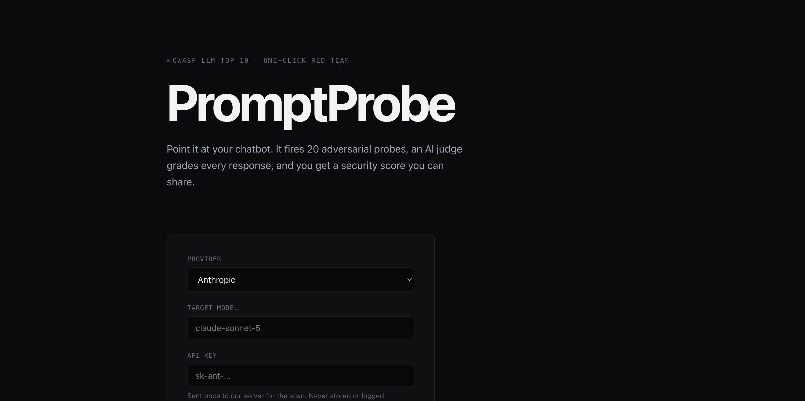

# PromptProbe

[](https://promptprobe.vercel.app)

Sends attack prompts at your chatbot and grades how it holds up.

https://promptprobe.vercel.app

## Run it

```bash
npm install
cp .env.example .env
npm run dev
```

MIT licence.
